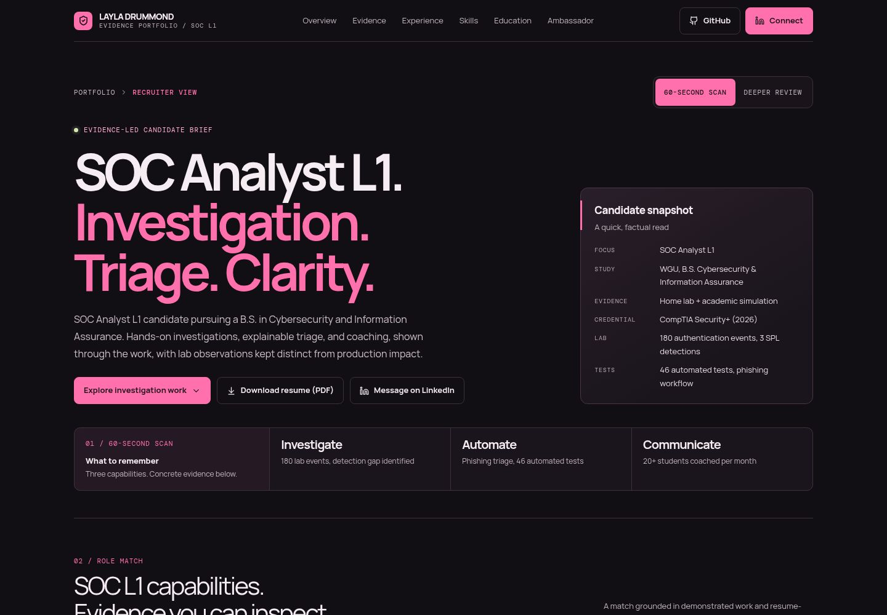

# SOC Analyst L1 — evidence portfolio

A recruiter-ready visual résumé website with a source-grounded virtual ambassador, plus a 30-second square animated portfolio film.



## Included

- **Website:** `artifacts/soc-portfolio` — pink-accented responsive portfolio, recruiter scan/deeper-review modes, project evidence, source library, and ambassador interface.
- **Backend:** `artifacts/api-server` — server-side ambassador calls, evidence citations, unsupported-question handling, prompt defenses, and rate limits.
- **Video project:** `artifacts/soc-portfolio-film` — editable React animation, instrumental music, and playback controls.
- **Finished video:** [Square MP4, 720 × 720, 30 seconds](media/portfolio-film.mp4).
- **Shared libraries:** `lib` — API definitions, generated clients, database schema, and server-side AI integration.
- **Downloadable résumé:** `artifacts/soc-portfolio/public/resume/Layla-Drummond-Resume.pdf` — the privacy-redacted public version only.

Claims are limited to the portfolio's supplied résumé and public project evidence. Home-lab and academic-simulation evidence is not presented as production SOC experience. LinkedIn messaging is the public contact method.

## Setup

This is a pnpm workspace. Install Node.js and pnpm, then run:

```sh
pnpm install
```

The artifact manifests contain the Replit development commands and preview paths. The three application services are:

```sh
# Website
PORT=18283 BASE_PATH=/ pnpm --filter @workspace/soc-portfolio run dev

# Video
PORT=21013 BASE_PATH=/soc-portfolio-film/ pnpm --filter @workspace/soc-portfolio-film run dev

# API — configure the required server-side environment first
PORT=8080 pnpm --filter @workspace/api-server run dev
```

Outside Replit, route `/api` to the API service and `/soc-portfolio-film/` to the video service. The website uses same-origin API URLs and expects this routing; independent development ports do not automatically proxy requests.

The API requires PostgreSQL and the database schema in `lib/db`, plus `DATABASE_URL`, `SESSION_SECRET`, `AI_INTEGRATIONS_OPENAI_BASE_URL`, and `AI_INTEGRATIONS_OPENAI_API_KEY` configured securely on the server. On Replit, configure the database and AI integration in the project. No values are included in this export.

## Privacy and repository contents

This snapshot excludes the original uploaded résumé, secrets, local files, agent conversations and memory, database data, workspace Git history, build outputs, dependencies, and browser-test captures.

Ambassador calls and credentials stay server-side. The application does not store or log chat content. The video ambassador demonstration is an illustrative excerpt, not a recorded recruiter conversation.

The finished MP4 is an existing exported asset; the video source and soundtrack are included for editing. The film is not embedded in the website by this export.
